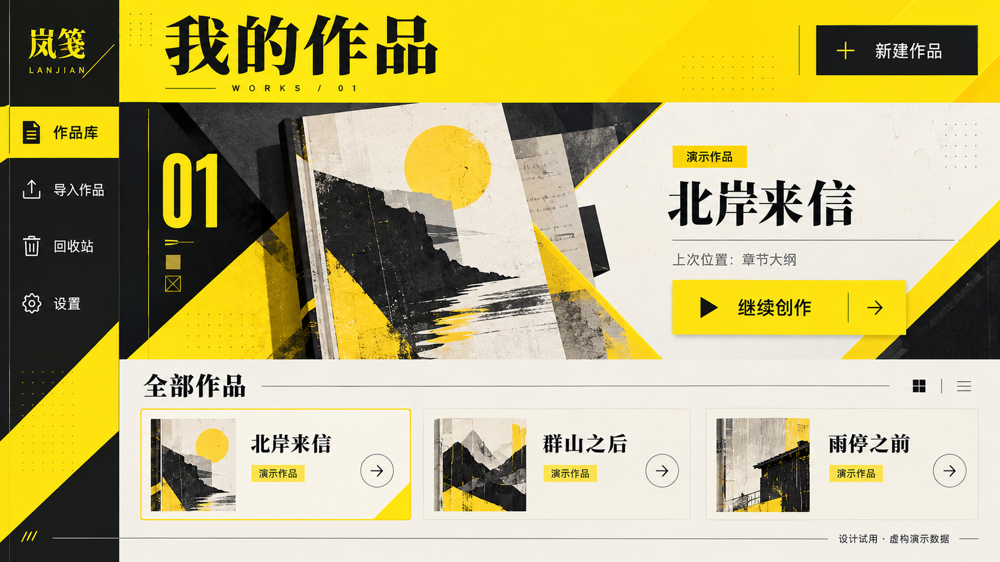
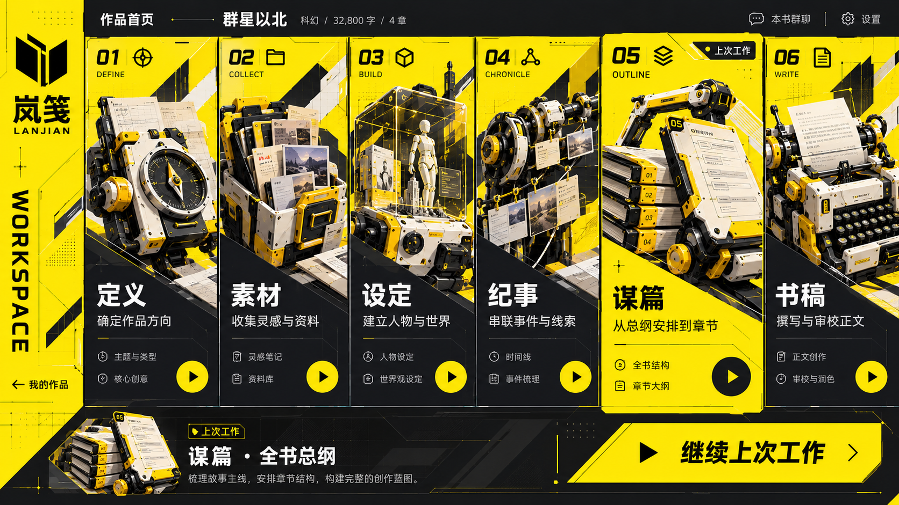
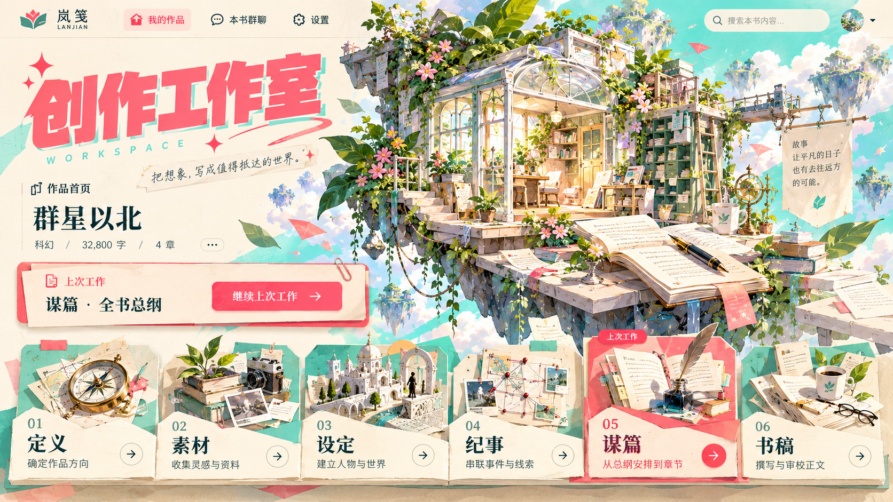

# Design Style Library · 由人把控方向的设计 Skill

一份用于风格选择、完整设计图、现有项目 UI 改造和组件动效的 Codex 技能。先用可追溯的原始参考帮助用户判断方向，再按请求制作图片或修改实际代码。

技能统一名称为 **`design-style-library`**。本仓库沿用历史地址 `lanjian-arknights-ui`；岚笺已发布档案终端作为内部可选预设保留，不默认把所有项目改成同一种风格。

## 能做什么

| 请求 | 工作方式 |
| --- | --- |
| 推荐设计风格 | 按用途推荐1—3个方向，展示可用原始参考并说明特点、适用原因和取舍 |
| 生成完整设计图 | 沿用用户选定或委托选择的方向，生成整张候选图，检查后按反馈迭代 |
| 改造现有项目 UI | 阅读项目规范、页面、组件与样式，复用现有结构，实际修改代码并运行相应检查 |
| 调整组件动画 | 区分原始动态参考与拟议参数，处理反馈、切换、进退场、快速反向和低动态落点 |
| 使用自己的风格库 | 连接已有库及来源索引；没有库时仍可用文字配方与用户描述工作 |

明确要求改代码时，直接进入实现流程，**不强制先生成图片**。以保留功能和业务连接为约束，验证受影响的页面、状态与交互；本技能不捆绑应用源码、前端框架或自动迁移引擎。

## 用户掌握方向

未指定风格时先推荐并等待选择；用户可以选一个、组合局部特征，或全部不选并自由描述。已有风格直接沿用，明确委托AI时由AI说明选择并继续。用户决定气质、内容优先级和重大取舍，AI完成方向内细节，不逐个按钮请求批准。

选风格使用原始参考、忠实预览、真实截图或原始动态资料。**AI生成图只能作为待评价的设计产出，不能充当原始风格示例。** 图片不可读时明确说明，不伪造展示或用生成稿补位。认可整图不自动触发拆组件、写代码或发布。

## 安装

将此仓库克隆到个人技能目录，目标目录使用统一名称。

Windows PowerShell：

```powershell
git clone https://github.com/jianghaisi/lanjian-arknights-ui.git "$env:USERPROFILE/.codex/skills/design-style-library"
```

macOS / Linux：

```bash
git clone https://github.com/jianghaisi/lanjian-arknights-ui.git ~/.codex/skills/design-style-library
```

自定义 CODEX_HOME 时，将目标放在该目录的 `skills/design-style-library` 下。

已安装旧 `lanjian-arknights-ui` 入口时，先保留自定义修改并将旧目录备份移出技能发现目录，再使用上述规范目录安装，避免同时加载两个入口。已有 `design-style-library` 目录时先对账，勿直接覆盖个人修改。

## 使用

先选方向：

```text
使用 $design-style-library，为这个作品管理页面推荐适合的风格，展示可用的原始参考图和取舍，让我选择。
```

直接改造现有项目：

```text
使用 $design-style-library，按已选定的黄黑工业方向改造当前项目的UI。
先读项目规范和现有组件，保留功能及业务连接；完成后运行项目检查，验证组件状态、键盘、窄屏和低动态表现。不发布。
```

指定岚笺发布预设：

```text
使用 $design-style-library，采用内部“岚笺发布版档案终端”预设改造这个页面，保留现有功能和组件职责。
```

## 参考资料与动效

[原始参考索引](references/style-preview-gallery.md) 提供28张风格卡、47份关联来源及动态归档的元信息快照。它包含候选、图标和字体语言，**不等于28套完整UI**；已有审阅状态不是当前环境的可用性或重新验收。

仓库不捆绑原始参考媒体和完整私人资料库。可接入自己的库、提供已有参考，或在允许范围内查看索引记录的原始地址；地址有效性与创作方式未核实时保留未知。没有图片时可按 [文字配方](references/portable-style-recipes.md) 原创设计，并标明尚未与原图核对。

[动效参数实验页](assets/motion-preview.html) 可下载后用浏览器离线打开，比较按钮反馈、选择指示器、局部抽屉与分层入场；无需外部依赖。它由本技能编写，只用于验证拟议参数，不是原作交互录屏。静态图片不能证明真实组件动画。

## 效果展示：作品库首页设计试用

### 作品库主档案 · 黄黑工业

用户委托选择黄黑工业方向，将编号、斜切与强对比转成“当前作品主档案＋作品集合”。这是统一技能的一次实际制作产出，岚笺发布预设仍保持其独立来源边界。



图像由内置图像工具生成，作品及数据均为虚构演示。它是静态设计候选，不作为原始风格参考或发布实机截图；组件动画尚未在此图中实现。

### 六阶段作品首页 · 黄黑工业

用黄黑强对比、机械装置、编号与分栏展示六个创作阶段，突出上次工作与继续入口。



### 创作工作室 · 珊瑚薄荷

用奶油纸底、珊瑚标题、薄荷色块和插画层叠建立轻快气氛，保留作品信息、继续入口与阶段导航。



以上两张为用户批准公开展示的生成概念稿，图中书名、字数、入口文案和附加功能用于设计演示，不代表真实作者数据或产品功能已实现。它们用于展示生成效果，不加入原始风格参考；静态图片不证明组件交互或动画已完成。

## 内部预设与文件

岚笺预设固定依据为 [jianghaisi/lanjian@0873296](https://github.com/jianghaisi/lanjian/tree/08732963211976c13f206d01732126d72afd5417)。其设计系统、页面与动效、来源三份附件保留原字节；另一套空间 UI 预研与官网艺术层不混入该预设。

| 文件 | 内容 |
| --- | --- |
| [SKILL.md](SKILL.md) | 单一入口、模式选择、原始参考和实现边界 |
| [方向与交互](references/interaction-and-direction.md) | 人工选择、设计约定、自由描述与迭代 |
| [文字配方](references/portable-style-recipes.md) | 可独立阅读的视觉关系与转译起点 |
| [动效指南](references/motion-and-components.md) | 原始动态参考、参数实验与验证 |
| [资料库连接](references/local-library.md) | 可选本地资料库接入 |
| [参考元信息](references/source-examples.json) | 来源ID、摘要、SHA及归档公开地址；不含媒体或本机路径 |
| [岚笺设计系统](references/presets/lanjian-release/design-system.md) | 冻结发布版的配色、排印、尺度和主题 |
| [岚笺页面与动效](references/presets/lanjian-release/patterns-and-motion.md) | 冻结页面职责与动效边界 |
| [岚笺来源](references/presets/lanjian-release/provenance.md) | 固定提交及公开证据 |

公开包不包含私人对话、作者作品、原始参考媒体、字体、声音、应用源码或本机绝对路径。发布预设不自动跟随应用主分支变化；具体项目改造遵循目标项目的规范和验证要求。
